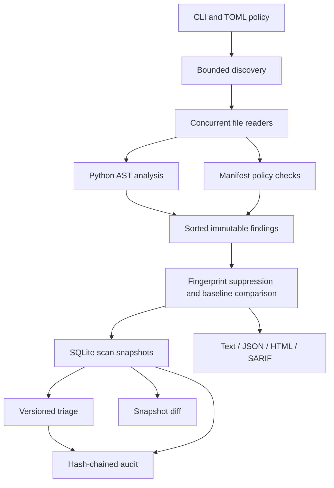

# Architecture

## Module boundaries

| Module | Responsibility |
|---|---|
| `models` | Immutable findings, traces, diagnostics and canonical serialization |
| `rules` | Rule IDs, descriptions, severities and remediation text |
| `config` | Strict TOML loading, resource policy and expiring suppressions |
| `flow` | Abstract values, lexical names, transfer functions and return summaries |
| `python` | AST sink rules and structural finding identity |
| `manifests` | Offline requirements and Dockerfile checks |
| `scanner` | File discovery, bounded reads, concurrency and deterministic ordering |
| `store` | Scan transactions, optimistic triage and audit validation |
| `baseline` | Portable baseline validation and export |
| `reports` | Output adapters and atomic file replacement |
| `cli` | Command composition and exit status policy |

Analysis workers receive paths and configuration, not database connections. They
return records; the coordinating thread sorts them and performs one persistence
transaction. This avoids sharing mutable SQLite connections between workers.

## Abstract value

A value contains a set of symbolic origins, a dynamic-value flag and a bounded
trace. Assignment replaces a variable's abstract value. Container writes merge
possible origins. Control-flow joins union possible origins; they do not choose
one branch based on runtime assumptions.

The transfer layer is independent of rule definitions. A call observer receives
argument flow and the current name resolver. Rules can inspect sinks without
re-evaluating arguments, which avoids duplicate side effects in the abstract state.

## Return summaries

Top-level functions are analyzed using symbolic parameter origins. Return summaries
are propagated through a bounded fixed-point iteration. At a call site, parameter
origins are substituted with the actual argument flows; literal-returning wrappers
do not inherit argument taint. Intrinsic sources in a wrapper remain sources.

This is not a whole-program call graph. Method dispatch, cross-module imports,
closures and arbitrary decorators are not resolved into interprocedural summaries.
Function parameters are also examined as caller-controlled boundaries when their
definitions are analyzed independently.

## Persistence

Snapshot writes and their audit event commit together. Review decisions are
conditional on the current version, and review events join the same transaction.
The audit chain includes hashes of stored scan content. Reports can be regenerated
from snapshots without reading the target source again.

## Reproducibility

Finding order is independent of worker completion order. Structural fingerprints
exclude line numbers and use a per-scope occurrence ordinal to distinguish identical
operations. Timestamps, scan IDs and elapsed time are intentionally not stable
across executions. Renaming paths or changing the operation's AST changes identity.
