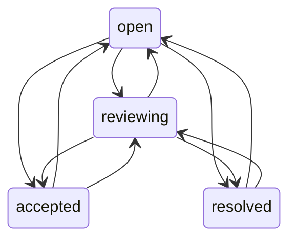

# Storage and audit

SQLite uses WAL mode, a busy timeout and foreign-key enforcement. Database access
is coordinated by the main process, not the file-analysis workers.

## Tables

| Table | Purpose |
|---|---|
| `metadata` | Schema version guard |
| `scans` | Project identity, creation time, policy digest and completeness metadata |
| `occurrences` | Immutable finding payload within a scan, keyed by fingerprint |
| `triage` | Current project/fingerprint review status and version |
| `audit` | Ordered canonical event payloads and chained hashes |

Saving a scan inserts its snapshot, occurrences, previously unseen open triage
entries and one audit event in a single `BEGIN IMMEDIATE` transaction. Duplicate
occurrences roll the entire transaction back. A finding can recur across scans
without losing its review state.

## Review states

Each decision requires the expected version, an actor label and a reason. Review
state does not change scan evidence, suppress a finding, or mark it absent from
future analysis. Suppression policy and baseline gating are separate mechanisms.

## Audit verification

Each event hash is SHA-256 over the prior hash and canonical JSON payload. Scan
events also contain a hash of scan metadata and sorted finding payloads. Verification
checks every link, sequence continuity, the autoincrement high-water mark, stored
snapshot hashes and review states reconstructed from events.

Update/delete triggers protect audit rows against accidental mutation. The tests
also remove those triggers and verify detection of modified events, deleted tails,
changed finding payloads and forged triage states.

This is tamper detection within a locally retained chain, not a signature or an
external trust anchor. A database owner can construct a replacement chain and
matching data. For stronger evidence, retain signed checkpoints outside the machine.

## Diff interpretation

Comparisons are restricted to the same project. `new`, `unchanged` and `absent`
refer to fingerprint set membership. An absent finding is not automatically a
resolved review decision. If either scan has diagnostics, the comparison is marked
incomplete and its CLI returns `2`.

## Backup

`backup` uses SQLite's online backup API, then closes the destination connection.
The result can be opened directly with `--database`. Copying only a live main
database file may omit WAL content and is not the backup procedure used here.
